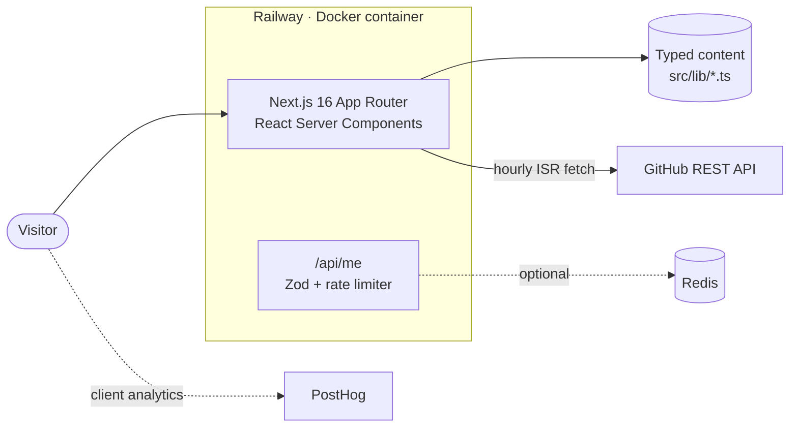
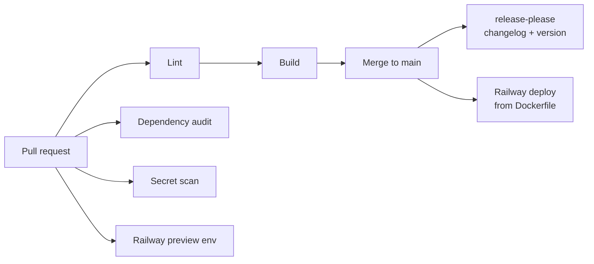

<div align="center">

# Barry Henry

**Solutions Engineer & Full-Stack Developer** · Maui, Hawaiʻi · Open to new roles

A decade of leading banking technology rollouts, plus full-stack products I design, build and ship myself.

[**View the live site →**](https://www.barryhenry.com) &nbsp;·&nbsp; [Resume](https://www.barryhenry.com/resume) &nbsp;·&nbsp; [Projects](https://www.barryhenry.com/projects) &nbsp;·&nbsp; [Get in touch](https://www.barryhenry.com/contact)


[](https://github.com/BarryHenryJr/barryhenry-portfolio-web/actions/workflows/cicd.yml)


</div>

---

## Who I am, in 30 seconds

I sit where customers, sales and engineering meet. At Cook Solutions Group I join qualified pre-sales calls for demos, discovery, scoping and RFP responses, then own the implementation through go-live. I've led **100+ NCR Interactive Teller Machine** rollouts and **80+ check imaging** rollouts for community banks and credit unions nationwide, and I build the C#, Python and PowerShell tools that fix customer problems before the permanent product fix ships.

Outside work I build full-stack products end to end with **TypeScript, React, Next.js, Node.js, Python and PostgreSQL**, from the data model to CI/CD to production hosting.

**What I bring to a team or a client:**

- **Technical discovery that turns into a working system.** I scope it, design it, stand up the infrastructure and stay through go-live.
- **Full-stack delivery.** Mobile, web, APIs, queues, databases, Docker and deploy pipelines, shipped by one person.
- **Calm in regulated environments.** Years of work inside financial institutions, where security, uptime and compliance are not optional.
- **Manufacturer certifications** across NCR, Vidyo, Lenel, RS2 and more.

> This repository is the source code for [barryhenry.com](https://www.barryhenry.com). It's both my portfolio and a working sample of how I build: typed end to end, validated at the edges, tested in CI and deployed automatically.

## Selected work

| Project | What it is | Built with |
| --- | --- | --- |
| **[TelemetryTaco](https://github.com/Agile-Flimflam/TelemetryTaco)** · open source | Self-hosted product analytics, a focused alternative to PostHog. Batch event ingestion with idempotency, a queue-backed Python SDK, and a one-command Docker Compose stack. | Python, Django Ninja, Celery, Redis, PostgreSQL, React |
| **Happy Harvest** · in development | Mobile-first planning app for farmers and gardeners that pairs modern tooling with the Hawaiian moon calendar (Mahina). | React Native (Expo), Fastify, PostgreSQL, Drizzle, Better Auth |
| **Happy Scheduler** · in development | Schedule one post to Instagram, Facebook and TikTok across several businesses, published exactly once by a Postgres-backed cron. | Next.js, Prisma, PostgreSQL, Playwright |
| **Banking ops tooling** · internal | On-the-job tools: PII detection and redaction for legacy logs, ATM transaction middleware for automated deposits, and a real-time status dashboard for video teller infrastructure. | C#, Python, PowerShell, Azure |
| **This portfolio** · live | The site you're reading about. Details below. | Next.js, Tailwind, shadcn/ui, Redis, Docker |

Each project has a full case study (problem, my role, architecture, status) on the [Projects page](https://www.barryhenry.com/projects).

## About this site

The portfolio is designed to feel like a **SaaS product dashboard**, because that's the world I work in.

- **Overview dashboard** with headline metrics, a tech radar, a milestone changelog and a **live "Latest commits" feed** pulled from my public GitHub repos.
- **Project case studies** at `/projects/[id]`, statically generated from typed content.
- **Experience timeline** styled as a versioned changelog (`v1.0.0` → `v7.0.0`).
- **Stack page** where every skill is backed by a named role or project, not a buzzword list.
- **Printable one-page resume** at `/resume`, with a print-to-PDF button.
- **Command palette** (`⌘K` / `Ctrl+K`) for keyboard-first navigation.
- **Public JSON API** at [`/api/me`](https://www.barryhenry.com/api/me): my profile as data, Zod-validated and rate limited.
- **Dark and light themes** that follow the system preference.

### Engineering highlights

| Area | What's in place |
| --- | --- |
| **Accessibility** | Lighthouse accessibility score of 100. Labelled controls, keyboard navigation and visible focus throughout. |
| **SEO** | Per-page metadata, a generated Open Graph image, `robots.txt`, `sitemap.xml` and JSON-LD `Person` structured data. |
| **API design** | `/api/me` validates its environment and data with Zod, sends CORS and no-store headers, and returns `429` with `Retry-After` when limits are hit. |
| **Rate limiting** | Redis-backed when `REDIS_URL` is set, with an automatic in-memory fallback, so the site never depends on Redis to stay up. |
| **Live data, safely** | The commits feed only reads repos already linked as public on a project card, so it can't expose private work. Cached for an hour to stay well under GitHub's API limits, and degrades to an empty state if GitHub is down. |
| **Analytics** | PostHog, enabled only when a key is supplied at build time, so local dev and forks send nothing. |
| **Content integrity** | All content lives in typed modules (`src/lib/*.ts`) sourced from my resume. No hardcoded copy scattered through components. |
| **Supply chain** | GitHub Actions pinned to commit SHAs, least-privilege workflow permissions, dependency audit and TruffleHog secret scanning on every PR. |

### Architecture



### Delivery pipeline



Every pull request gets lint, a production build, a dependency audit, secret scanning and its own Railway preview environment. Merges to `main` deploy automatically, and [release-please](https://github.com/googleapis/release-please) turns conventional commits into versioned releases and the [CHANGELOG](CHANGELOG.md).

## Tech stack

| Layer | Tools |
| --- | --- |
| **Framework** | Next.js 16 (App Router, Turbopack), React 19, TypeScript (strict) |
| **UI** | Tailwind CSS 4, shadcn/ui on Radix UI, Framer Motion, Lucide icons, cmdk, next-themes |
| **Data & validation** | Zod, typed content modules, GitHub REST API with incremental static regeneration |
| **Backend** | Next.js route handlers, fixed-window rate limiter on Redis (`redis` client) with an in-memory fallback |
| **Observability** | PostHog product analytics |
| **Tooling** | pnpm 9.15, ESLint 9, Husky pre-commit hooks |
| **CI/CD & hosting** | GitHub Actions, release-please, Docker, Railway |

## Run it locally

**Prerequisites:** Node.js 20.18+ and pnpm 9.15.0.

```bash
git clone https://github.com/BarryHenryJr/barryhenry-portfolio-web.git
cd barryhenry-portfolio-web
pnpm install
pnpm dev
```

Then open [http://localhost:3000](http://localhost:3000). No environment variables are needed to run it.

### Optional environment variables

| Variable | Purpose |
| --- | --- |
| `REDIS_URL` | Use Redis for `/api/me` rate limiting instead of the in-memory fallback. |
| `GITHUB_TOKEN` | Raise the GitHub API limit for the "Latest commits" feed. |
| `NEXT_PUBLIC_POSTHOG_KEY` | Turn on PostHog analytics. Read at **build** time, so it must be passed as a Docker build arg. |
| `NEXT_PUBLIC_POSTHOG_HOST` | PostHog ingestion host. Defaults to `https://us.i.posthog.com`. |

### Scripts

```bash
pnpm dev        # Start the dev server
pnpm build      # Production build
pnpm start      # Serve the production build
pnpm lint       # ESLint (also runs on pre-commit)
```

### Project structure

```
src/
├── app/                 # App Router pages, API route, OG image, robots, sitemap
│   ├── api/me/          # Public JSON profile API
│   ├── projects/[id]/   # Case study pages
│   ├── experience/      # Changelog-style timeline
│   ├── stack/           # Skills, each tied to a role or project
│   ├── resume/          # Printable one-page resume
│   └── contact/
├── components/
│   ├── dashboard/       # Tech radar, activity feed, live commits
│   ├── layout/          # Shell, sidebar, status bar
│   └── ui/              # shadcn/ui primitives
└── lib/                 # Typed content, case studies, resume, GitHub client
```

## Let's talk

I'm open to **solutions engineering and full-stack roles**, and to **freelance builds** for teams that need someone who can scope it, build it and ship it.

- **Website:** [barryhenry.com](https://www.barryhenry.com)
- **Email:** [barryhenryjr@gmail.com](mailto:barryhenryjr@gmail.com)
- **LinkedIn:** [linkedin.com/in/barrynhenry](https://linkedin.com/in/barrynhenry)

A full resume is available on request.
